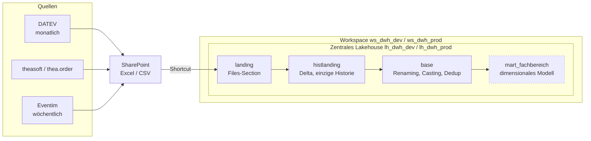
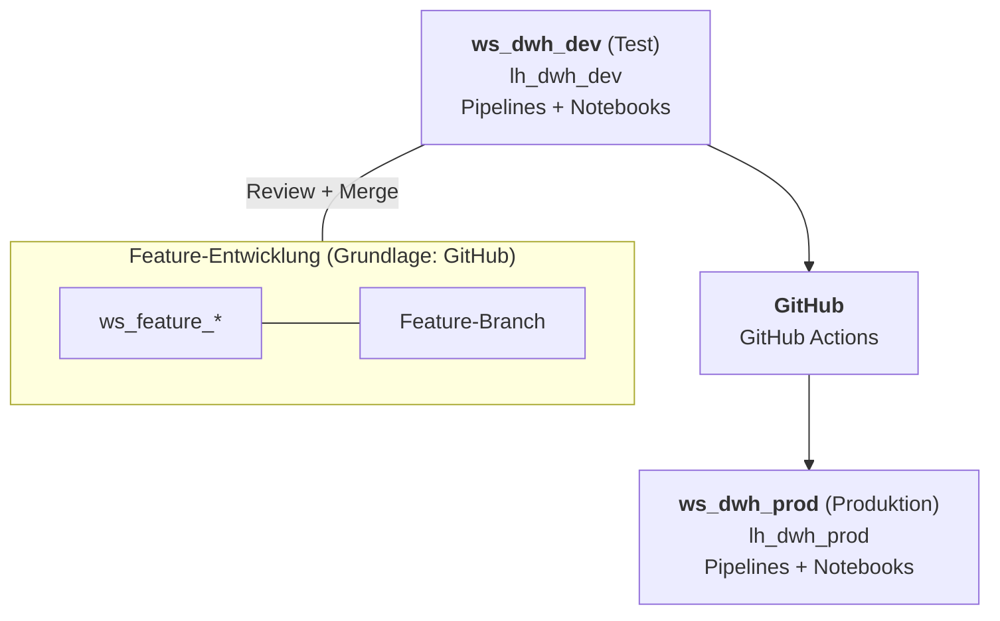

# Architecture Overview

Einstiegsseite zur Zielarchitektur. Sie zeigt das Gesamtbild und verlinkt in die Detaildokumente;
Details und Begründungen stehen nur dort. Wie überall in dieser Doku gilt der **Soll-Zustand**,
nicht der Stand des Codes. Status-Legende siehe [Index](../index.md).

In den Diagrammen sind **geplante** Elemente gestrichelt, **offene** gepunktet dargestellt.

## 1. Kontext und Datenfluss

Quellen liefern kurzfristig Excel/CSV über SharePoint. Die Daten durchlaufen vier Layer im
zentralen Lakehouse, das im Workspace `ws_dwh_dev` bzw. `ws_dwh_prod` liegt. Der Mart je
Fachbereich liegt als Schema im selben Lakehouse. Eine Bereitstellung in eigenen Workspaces per
Shortcut ist **zurückgestellt**, bis der Fachbereich bestätigt, dass er direkten Datenzugriff
braucht.

Das Datenmodell von `mart_*` ist **offen**. Semantisches Modell, Reports und die Bereitstellung
an Fachbereiche sind noch nicht beschrieben. Details: [Storage Layers](storage-layers.md),
[Sources](sources.md), [ADR 0001](../adr/0001-storage-zone-layout.md).

## 2. Workspace-Struktur

Workspaces folgen der Separation of Concerns: wer verwaltet, wer sieht. `ws_dwh_dev` ist der
Test-Workspace, in dem Änderungen aus den Feature-Branches zusammenkommen. Entwickelt wird in
`ws_feature_*` auf Basis von GitHub. Von `ws_dwh_dev` nach `ws_dwh_prod` läuft die Promotion über
GitHub Actions.

Details: [Naming Conventions](naming-conventions.md), [Deployment](deployment.md).

## 3. Building Blocks

| Baustein | Technik | Aufgabe | Doku |
|---|---|---|---|
| Speicher | Fabric Lakehouse (OneLake, Delta) | Ein Lakehouse je Umgebung, Layer als Schemas | [Storage Layers](storage-layers.md) |
| Orchestrierung | Fabric Data Pipelines | Master + Subpipelines, Parameter, MLV-Refresh, E-Mail-Alerting | [Orchestration](orchestration.md) |
| Verarbeitung histlanding | Standardformate config-getrieben; Excel: Custom-Notebook, Single-Node (DuckDB + delta-rs präferiert, Engine-Wahl **offen**) | Ingestion, Schema-Check, Merge | [Storage Layers](storage-layers.md), [ADR 0003](../adr/0003-single-node-excel-ingestion.md) |
| Verarbeitung base | PySpark, config-getrieben | Renaming, Casting, Dedup | [Storage Layers](storage-layers.md) |
| Verarbeitung mart | Materialized Lake Views (Spark SQL); PySpark bei SCD2 | Dimensionales Modell je Fachbereich | [Storage Layers](storage-layers.md) |
| Konfiguration | Variable Library, Custom Environment | Umgebungswerte (abfs-Pfade), Spark-Settings, Packages | [Deployment](deployment.md) |
| Deployment / CI | GitHub Actions + fabric-cicd; Unit-Tests, ruff | Einziger Weg in die Workspaces | [Deployment](deployment.md) |
| Datenqualität | Schema-Check, Great Expectations | `info` loggt, `error` bricht ab | [Data Quality](data-quality.md) |
| Zugriff | Entra-ID-Gruppen, Workspace-Rollen, OneLake Security (RBAC) | Rechte auf Mart-Daten | [Access Control](../security/access-control.md) |
| Secrets | Azure Key Vault | Keine Secrets im Code | [Access Control](../security/access-control.md) |
| Compute | Fabric Capacity F2 | Rahmen für alle Workloads | [Deployment](deployment.md) |

## Offene Punkte mit Architekturbezug

Die vollständige Liste steht im [Index](../index.md). Für das Gesamtbild sind relevant:

- Engine-Wahl für die Excel-Ingestion und Prüfung der delta-rs-Merge-Fähigkeit.
- Bereitstellung an Fachbereiche (nach Rücksprache).
- Datenbereitstellung im Mart: MLVs oder weitere Werkzeuge (z. B. dbt).
- CI-Details: Notebook→Python-Konvertierung, ruff-Konfiguration.
