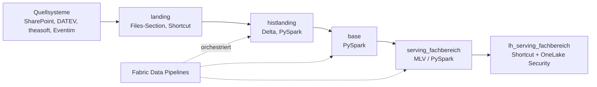

# Datenarchitektur DWH – Soll

Leitprinzip: **Pragmatismus und Stabilität.**

Diese Dokumentation beschreibt die **Zielarchitektur** der DWH-Plattform. Sie ist aus dem
Konzept (Notion „Konzeption Datenarchitektur") und den Regeln in `AGENTS.md` abgeleitet und
gilt als Sollbeschreibung, nicht als Beschreibung eines bereits vollständig umgesetzten Stands.
Der aktuell im Repository liegende Code ist **nicht** die Quelle dieser Beschreibung.

## Status-Legende

Jede Aussage in dieser Doku gehört in eine der drei Kategorien. Wo nichts anderes steht, gilt
sie als **entschieden**.

| Status | Bedeutung |
|---|---|
| **entschieden** | Fachlich oder technisch festgelegt, in `AGENTS.md` verankert. |
| **geplant** | Entschieden, aber noch nicht umgesetzt. |
| **offen** | Bewusst unentschieden; Entscheidung ist im Agent-Betrieb untersagt (siehe `AGENTS.md` §9). |

## Gesamtbild

Alle Layer liegen als Schemas in einem zentralen Lakehouse je Umgebung. Die Daten durchlaufen
vier Stufen; die Auslieferung an die Fachbereiche erfolgt über Shortcuts, ohne physische Kopie.

## Layer-Übersicht

| Layer | Ort | Technik |
|---|---|---|
| landing | Files-Section des zentralen Lakehouse | OneLake-Shortcut auf SharePoint, keine Logik |
| histlanding | Schema `histlanding` | PySpark; Excel via pandas, alle Spalten als String |
| base | Schema `base` | PySpark: Renaming, Casting, Dedup, Formate |
| serving_&lt;fachbereich&gt; | eigenes Schema je Fachbereich | Materialized Lake Views (Spark SQL), sonst PySpark |

## Dokumente

- [Architecture · Storage Layers](architecture/storage-layers.md) – Layer, Orte, Techniken, Fluss
- [Architecture · Sources](architecture/sources.md) – Quellen, Kadenz, zentraler Schlüssel
- [Architecture · Formats](architecture/formats.md) – Dateiformate
- [Architecture · Naming Conventions](architecture/naming-conventions.md) – Workspaces, Lakehouses, Schemas, Tabellen, Notebooks
- [Architecture · Lifecycle & Retention](architecture/lifecycle-retention.md) – Historie, Wartung
- [Architecture · Orchestration](architecture/orchestration.md) – Pipelines, Parameter, Alerting
- [Architecture · Data Quality](architecture/data-quality.md) – Schema-Check, Great Expectations
- [Architecture · Deployment](architecture/deployment.md) – CI/CD, Umgebungen, Capacity
- [Security · Access Control](security/access-control.md) – Workspaces, Entra-Gruppen, OneLake Security
- [ADR · Storage Zone Layout](adr/0001-storage-zone-layout.md)
- [CHANGELOG](CHANGELOG.md)

## Offene Punkte (Überblick)

Die folgenden Themen sind bewusst unentschieden. Sie sind hier gesammelt, damit sie auffindbar
bleiben:

- Datenmodell für `serving_*` (dimensionales Modell noch unbekannt).
- Ob eine Historisierung (SCD2) in `serving_*` gewünscht ist und damit MLV oder PySpark.
- Config-getriebene Build-Notebooks vs. einzelne Notebooks je Entität.
- Umgang mit in der Quelle gelöschten Zeilen.
- Shortcut-Transformation vs. pandas-Ingestion.
- Retention-Werte und Wartungsregel (VACUUM / Table Maintenance) für `histlanding`.
- Feingranulares RBAC-Konzept.
- Ablage der Great-Expectations-Regeln und -Ergebnisse.
- Variable Library: Name, Variablen, Value Sets.
- Zu diskutieren: Python-Notebooks statt PySpark für histlanding/base auf der F2.
- F0: prüfen, sobald verfügbar.
- Katalog-Sichtbarkeit pfadgeschriebener Tabellen für MLVs.
- Lakehouse-Bindung der MLV-Notebooks beim Deployment.
